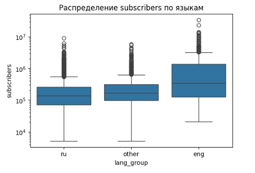
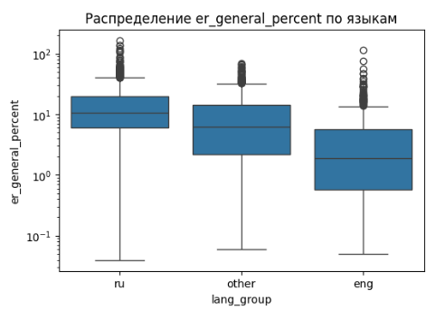
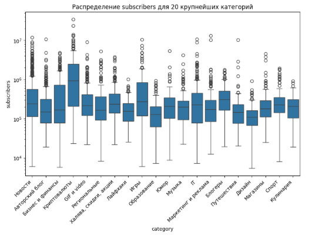
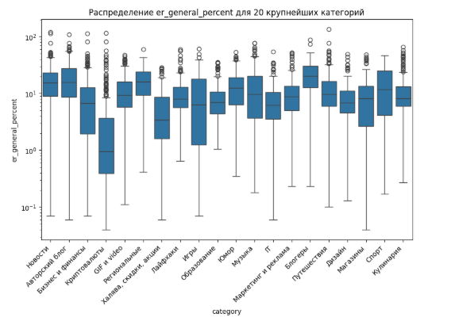
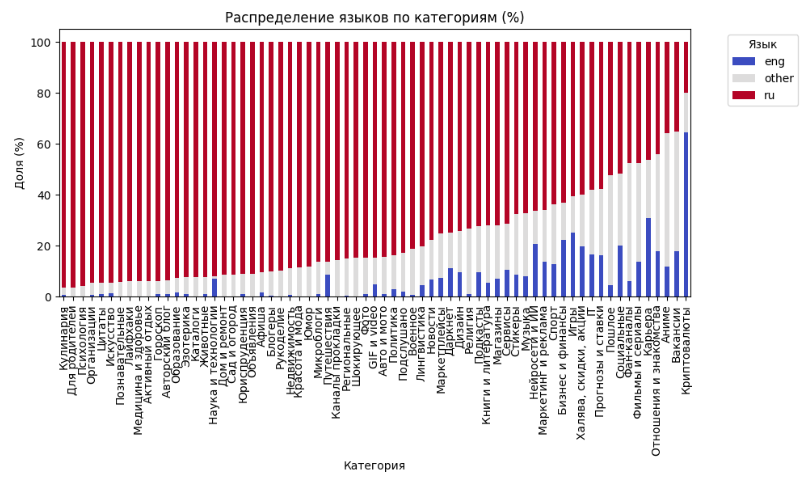
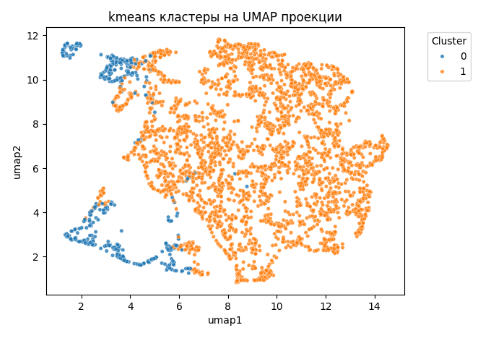
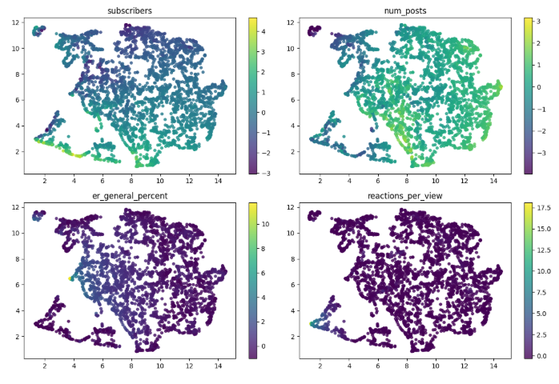
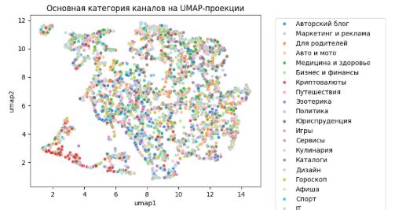
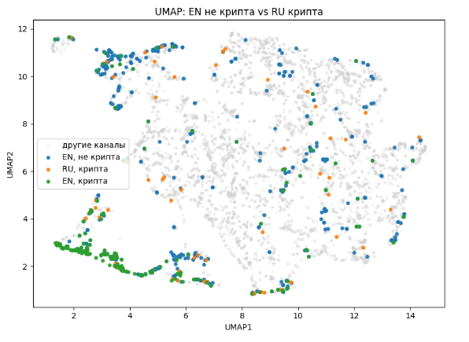

# Анализ статистики телеграм-каналов

## Парсинг каталога каналов

Источник данных: https://telemetr.me/ – агрегатор телеграм-каналов

На сайте есть категории, и в каждой категории доступно топ 100 каналов по количеству подписчиков. Загружались данные всех каналов из всех категорий, доступных на сайте. 
Часть столбцов собиралась со страниц категорий, часть – со страниц самих каналов.

- Количество категорий: 67
- Количество каналов: 5026

Структура полученной таблицы:

| Столбец                | Описание                                                                        |
| ---------------------- | ------------------------------------------------------------------------------- |
| **key**                | Уникальный идентификатор канала                                                 |
| **name**               | Название канала                                                                 |
| **telemetr_url**       | Ссылка на страницу канала на сайте                                              |
| **tme_url**            | Ссылка на канал                                                                 |
| **avatar_url**         | URL изображения аватара канала                                                  |
| **subscribers**        | Количество подписчиков                                                          |
| **subs_delta_day**     | Изменение количества подписчиков за сутки                                       |
| **views_per_post**     | Среднее количество просмотров одного поста                                      |
| **num_posts**          | Количество постов на канале                                                     |
| **num_messages**       | Количество сообщений                                                            |
| **num_quotes**         | Количество репостов канала                                                      |
| **num_replies**        | Количество ответов на посты канала                                              |
| **num_likes**          | Количество лайков                                                               |
| **description**        | Описание канала                                                                 |
| **er_general**         | Общий ER                                                                        |
| **er_daily**           | Среднесуточный ER                                                               |
| **last_post_content**  | Текст последнего поста на канале                                                |
| **last_post_datetime** | Дата и время публикации последнего поста (в формате `ДД.ММ.ГГГГ ЧЧ:ММ`).        |
| **language**           | Язык текста последнего поста (например `ru`, `en`).                             |

- Engagement Rate (ER) – Отношение среднего числа просмотров на пост за последние 7 дней к числу подписчиков.
- Язык текста последнего поста определялся с помощью библиотеки langdetect

Для отображения соответствия категории и канала использовалась дополнительная таблица (т.к канал может относиться к нескольким категориям):

| Столбец                | Описание                                                                        |
| ---------------------- | ------------------------------------------------------------------------------- |
| **key**                | Уникальный идентификатор канала                                                 |   
| **category**           | Категория канала                                                                |
 

## Предобработка и разведочный анализ (EDA)
Полученные данные были предобработаны для дальнейшего построения моделей:
   - Обработаны пропуски и выбросы, преобразованы типы столбцов, добавлены новые признаки.
   - Проведён анализ распределений, взаимосвязей признаков, построены визуализации.












## Модель обучения с учителем
Была построена модель логистической регрессии для предсказания языка канала в Телеграме (руссий или английский) по параметрам:
- число подписчиков на пост
- среднесуточный ER
- число категорий, в которые входит канал

Был использован градиентный спуск и L2 регуляризация.

Метрики sklearn:
```
precision    recall  f1-score   support

         0.0       0.82      0.61      0.70        69
         1.0       0.69      0.87      0.77        69

    accuracy                           0.74       138
   macro avg       0.76      0.74      0.73       138
weighted avg       0.76      0.74      0.73       138
```
Метрики реализованной модели:
```
precision    recall  f1-score   support

         0.0       0.81      0.57      0.67        69
         1.0       0.67      0.87      0.75        69

    accuracy                           0.72       138
   macro avg       0.74      0.72      0.71       138
weighted avg       0.74      0.72      0.71       138
```

Таким образом, по выбранным статистикам с высокой точностью можно предсказать язык канала.


## Модель обучения без учителя
Для кластеризации были отобраны следующие параметры:
- число подписчиков
- число постов
- общий ER
- отношение реакций к просмотрам 

Использовались методы K-Means и GMM, для визуализации были выполнены проекции PCA и UMAP.

Визуализация на UMAP-проекции:









Заметно, что англоязычные каналы в целом, и о криптовалютах в частности, отличаются по поведению от основной массы русскоязычных телеграм-каналов. Англоязычные каналы о криптовалютах имеют много подписчиков, невысокое число постов, низкие просмотры и много реакций. Возможное объяснение: использование ботов для накрутки реакций (также можно предположить наличие вознаграждения за реакции или других особенностей взаимодействия аудитории с контентом)

## Как запустить

Для парсинга:
- Установить зависимости: `pip install -r requirements.txt`
- Запустить сбор данных: `python parse.py`

Итоговые таблицы для анализа помещаются в `data/final`. (сейчас там хранятся данные, актуальные на 7 октября 2025 года)

Для анализа:
- загрузить `analysis.ipynb` и папку `data/final` в Google Colab
- выполнить все ячейки ноутбука